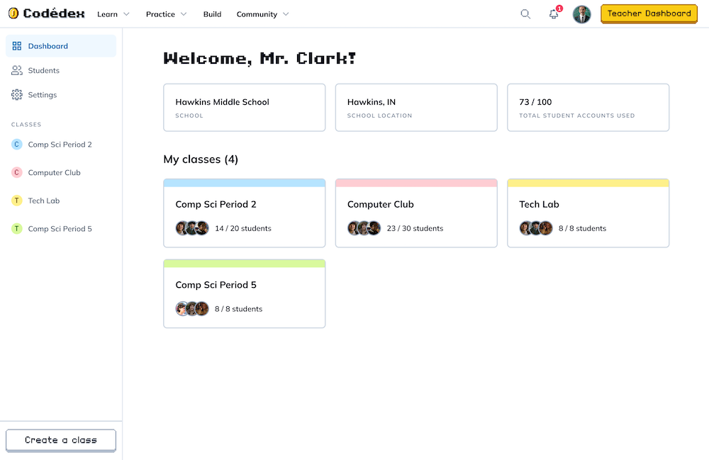
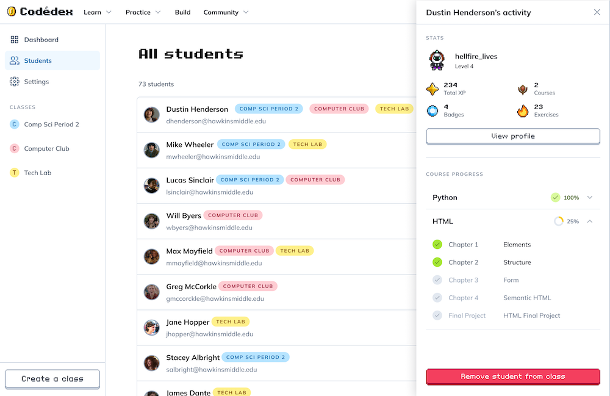
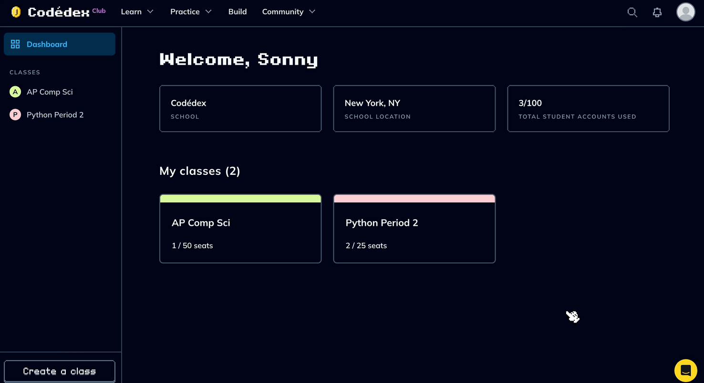

## 👋 Hellooo!

Welcome to our educator community! If you’re reading this, chances are you’ve been looking for fun and engaging ways to get your students coding for the first time.

Last month, we relaunched our [Codédex For Educators](https://www.codedex.io/educators) plan, and I thought it was the perfect time to send you a little update! 

Here’s what’s new at Codédex:

- 🚌 **Codédex For Educators**
- 🧑‍🏫 **Teacher Dashboard**
- ⚙️ **Community Settings**

We even got to demo these new features IRL at the [CSTA New York Conference](https://www.instagram.com/p/DfyCR5uI4Nl/?img_index=1), and teachers absolutely loved them!

Let's get into it~

---

## 🚌 Codédex For Educators

<Caption text="www.codedex.io/educators" />

You asked, and we delivered. After serving 800+ schools worldwide, we’re excited to launch **Codédex For Educators**, a new plan designed to help teachers bring Codédex into their classrooms!

### How does the Codédex For Educators plan work?

For classrooms with **up to 150 students**, we're offering special introductory pricing:

<ul>
  <li style={{ position: "relative" }} className="li-p-with-image">
    
    
      

         **One semester (5 months):** $2.49 per student account
      

    
  </li>
  <li style={{ position: "relative" }} className="li-p-with-image">
    
    
      

        **One year (12 months):** $3.99 per student account
      

    
  </li>
</ul>

**Note:** For schools/districts with more than 150 students, [contact us](mailto:sonny@codedex.io) for custom pricing.

### What does it include?

Both plans include access to our **Teacher Dashboard**, where you can manage your students and track their progress in one place. As well as our [full content catalog](https://codedex.io/courses), covering [Python](https://codedex.io/python), [Java](https://codedex.io/java), [HTML](https://codedex.io/html), [CSS](https://codedex.io/css), [JavaScript](https://codedex.io/javascript), Web Development, Game Development, Artificial Intelligence, Data Science, Machine Learning, UI/UX Design, and much more.

  <a
    href="https://www.codedex.io/educators"
    style={{ all: "unset" }}
    target="_blank"
    and
    rel="noopener noreferrer"
  >
    <Button variant="yellow">See Codédex For Educators</Button>
  </a>

---

## 🧑🏼‍🏫 Teacher Dashboard

So, what exactly is the Teacher Dashboard, and what can it do?!

### Customize your classrooms

<Caption text="You can create multiple classes!" />

Update coursework and classroom names, and assign students to individual class sections. You can add students with an invite link.

### See individual student progress

<Caption text="Hmm did Dustin finish HTML Chapter 2 yet?" />

Get a clear picture of how each student is progressing through a course! Track their learning journey and see which exercises they've completed.

---

## ⚙️ Community Settings

<Caption text="Customize your classroom learning experience." />

Per your feedback, we’ve just introduced new **[Edit class]** settings in the top-right corner of your Teacher Dashboard! You can now:

- Disable [/Community](https://codedex.io/community) for your classrooms.
- Hide student accounts from [profile search](https://www.codedex.io/search).

We're excited to give educators more control over their classrooms!

---

## 👾 About Codédex

<Caption text="Codédex team in Brooklyn, NY." />

Just in case you forgot who we are:

[Codédex](https://codedex.io) is a gamified learning platform that teaches people tech skills. Founded in 2022 and headquartered in NYC, we’ve grown to 2.5M learners worldwide and reached 800+ schools. 

Our mission is simple: 

> Build the best tech education in the world and make it accessible to the next generation of builders and dreamers. ❤️‍🔥

Let’s work together and bring Codédex into your classroom!

  <a
    href="https://www.codedex.io/educators"
    style={{ all: "unset" }}
    target="_blank"
    and
    rel="noopener noreferrer"
  >
    <Button variant="yellow">View Codédex For Educators</Button>
  </a>

<Quote text="I am a high school science teacher in a school without a CS program and Codédex has been an amazing option for us! With little experience myself, students were able to navigate the program completely independently. We did presentations on what they learned/created/accomplished and it was far more than I ever imagined. We love Codédex!!” - Ian Howes, Science Teacher @ Springfield Honors Academy" />

<Quote text="Everything’s going really well – the platform and UI are fantastic!” - Josiah Friedberg, CS Teacher @ Fishers Island School" />

P.S. Know another CS teacher? Forward this email and spread the love!
