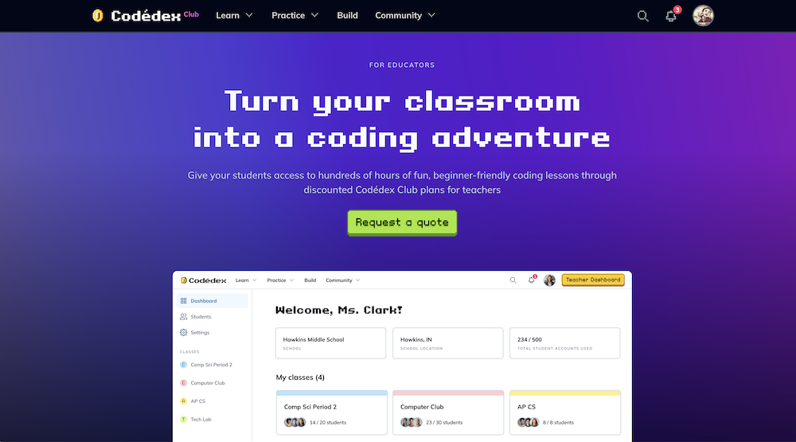

## 👋 Welcome to our educators community!

Hellooo! If you’re reading this, chances are you’ve been looking for fun and engaging ways to get your students coding for the first time.

Last month, we relaunched our brand new [Codédex For Educators](https://www.codedex.io/educators) plan, and I thought it was the perfect time to send you a little update! 

Here’s what’s new at Codédex:

- 🚌 **Codédex For Educators**
- 🧑‍🏫 **Teacher’s Dashboard**
- ⚙️ **Community Settings**

We even got to demo these new features IRL at the [CSTA New York Conference](https://www.instagram.com/p/DfyCR5uI4Nl/?img_index=1), and teachers absolutely loved them!

Let's get into it~

---

## 🚌 Codédex For Educators

<Caption text="www.codedex.io/educators" />

You asked, and we delivered. After serving 800+ schools worldwide, we’re excited to officially launch **Codédex For Educators**, a new plan designed to help teachers bring Codédex into their classrooms!

### How does the Codédex For Educators plan work?

For classrooms of **up to 200 students**, we can offer a special pricing:

- One semester (5 months)
- One school year (12 months)

### What does it include?

Both plans include access to our **Teacher's Dashboard**, where you can manage your students and track their progress in one place.

As well as our [full content catalog](https://codedex.io/courses), covering [Python](https://codedex.io/python), [Java](https://codedex.io/java), [HTML](https://codedex.io/html)/[CSS](https://codedex.io/css), [JavaScript](https://codedex.io/javascript), Web Development, Game Development, Artificial Intelligence, Data Science, Machine Learning, UI/UX Design, and much more.

  <a
    href="https://www.codedex.io/educators"
    style={{ all: "unset" }}
    target="_blank"
    and
    rel="noopener noreferrer"
  >
    <Button variant="yellow">See Codédex For Educators</Button>
  </a>

**Note:** For schools/districts with 200+ students, we offer bulk packages! [Email us](mailto:sonny@codedex.io).

---

## 🧑🏼‍🏫 Teacher's Dashboard

You can now manage your students and track their progress in one place!

### Customize your classrooms

<Caption text="TBD" />

Update coursework and classroom names, and assign students to individual class sections. You can add students with an invite link.

### See individual student progress

<Caption text="TBD" />

Get a clear picture of how each student is progressing through a course! Track their learning journey and see which exercises they've completed.

---

## ⚙️ Community Settings

<Caption text="TBD" />

Per your feedback, we’ve just introduced new **[Edit class]** settings in the top-right corner of your Teacher’s Dashboard! You can now:

- Disable /Community for your classrooms.
- Hide student accounts from profile search.

We're excited to give educators more control over their classrooms!

---

## 👾 About Codédex

Just in case you forgot who we are:

[Codédex](https://codedex.io) is a online, gamified learning platform that teaches people tech skills. Founded in 2022 and headquartered in NYC, we’ve grown to 2.5 million learners worldwide and reached 800+ schools.

Our mission is simple: 

> _Build the best tech education in the world and make it accessible to the next generation of builders & dreamers._

<Caption text="TBD" />

❤️ - Codédex team

  <a
    href="https://www.codedex.io/educators"
    style={{ all: "unset" }}
    target="_blank"
    and
    rel="noopener noreferrer"
  >
    <Button variant="yellow">View Codédex For Educators</Button>
  </a>

<Quote text="Everything’s going really well – the platform and UI are fantastic! - Josiah Friedberg, CS Teacher @ Fishers Island School (NY)" />
