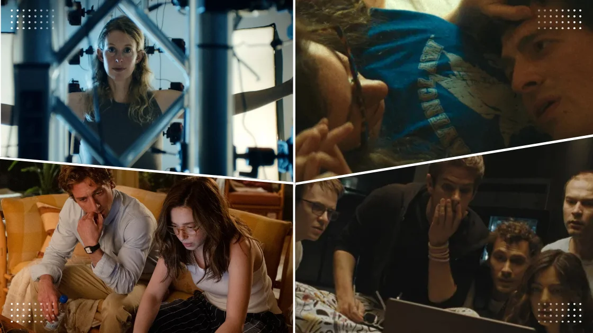
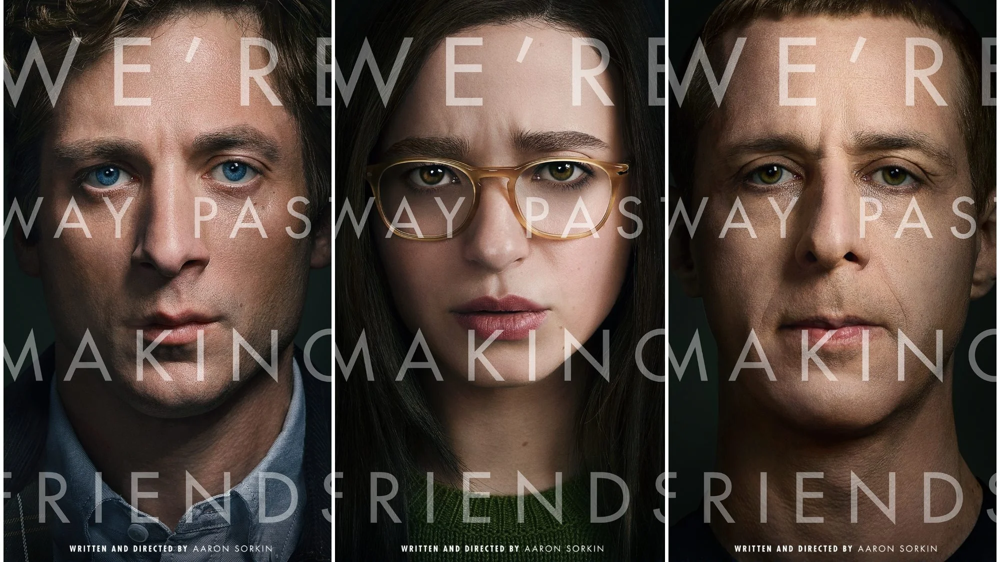
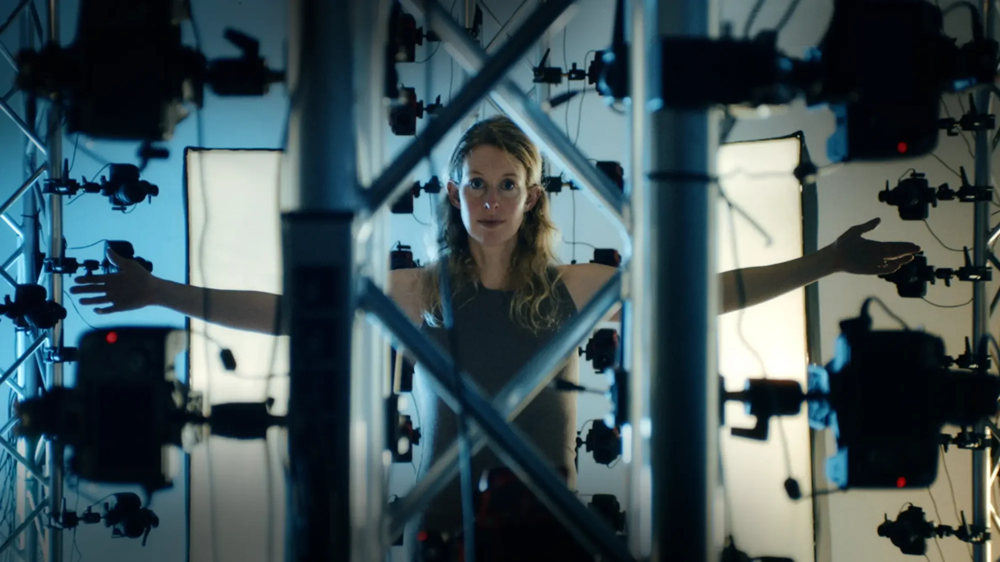
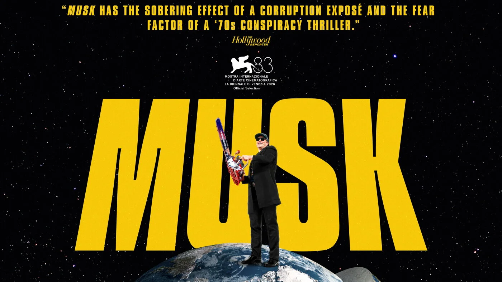

</img>

Hi fellow builders,

It's your boy Sonny. I'm joining the Monthly Challenge to try to snag the last badge! 😏

I've always been a big sucker for tech movies, TV shows, and docuseries. And this season, we're getting not one, not two, but a whole lineup of tech stories to nerd out over. So excited.

Let's go through them in order of their their release dates.

## 1. The Social Reckoning (Film)

_October 9, 2026_

</img>

Aaron Sorkin returns to the world of The Social Network, this time to examine the consequences of Facebook's success rather than its founding story. It focuses on events that gave rise to Wall Street Journal’s shocking exposé, The Facebook Files. It's inspired by the true story of how Frances Haugen, a young Facebook engineer, enlists the help of Jeff Horwitz, a WSJ reporter, to go on a dangerous journey that ends up blowing the whistle on the social network’s most guarded secrets.

Jeremy Strong (Succession) portrays Zuck, with Mikey Madison (Anora) as Haugen and Jeremy Allen White (The Bear, Shameless) as journalist Jeff Horwitz. Wait, is that Bill Burr?

Sony Pictures Entertainment.

**Why watch**: It's no longer about building Facebook. It's about what happens when the platform becomes too powerful to ignore. But too bad Jesse Eisenberg isn't in it.

[Watch trailer](https://www.codedex.io/community/tech-news/6SIJjhDWYsV2lmk0n1aZ?re=tech-news)

## 2. You Can See Everything (Documentary)

_October 16, 2026_

</img>

What begins as following Elizabeth Holmes, founder of Theranos, 34 days before she's sent to federal prison becomes a mind-bending three-year journey into the abyss. This is part of Rotten Tomatoes' The Most Anticipated Movies of 2026. 2 hr 54 min long.

A24.

**Why watch**: Everyone has gone down the Theranos scandal rabbit hole once in their lifetime. And they let Nathan Fielders and Lance Oppenheim do this?! I am a HUGE Nathan Fielders fan (Nathan for You). I also just saw Primetime by Lance Oppenheim and it was awesome. BEYOND excited for this one.

[Watch trailer](https://www.codedex.io/community/tech-news/OT0MXIgS3smvkaIOCJYF?re=tech-news)

## 3. Musk (Documentary)

_October 16, 2026_

</img>

The world's most polarizing tech billionaire trillionaire gets the documentary treatment. Oscar-winning filmmaker Alex Gibney explores Elon Musk's rise, his companies, his public persona, and his expanding influence across technology and politics. Running approximately four hours, this is anything but a quick biography.

**Why watch**: Whether you're fascinated by Tesla and SpaceX or skeptical of Musk's influence, this documentary promises a critical look at the man behind the empire. I might skip this one tbh since I've read his books and tired of hearing about him.

[Watch trailer](https://www.youtube.com/watch?v=FFTf1lzcs28)

## 4. The Altruists (Netflix Series)

_November 19, 2026_

</img>

Netflix dives into the rise and fall of FTX, the cryptocurrency exchange once valued in the billions. Anthony Boyle (House of Guinness) plays Sam Bankman-Fried aka SBF, while Julia Garner (Ozark, Inventing Anna) portrays Caroline Ellison. The eight-episode series explores their relationship, ambition, and the scandal that brought the crypto empire down.

**Why watch**: I don't know much about the SBF story, so definitely gonna watch this!

[Watch trailer](https://www.youtube.com/watch?v=9aGeKSSyuhk)

## 5. Artificial (Film)

</img>

Remember when OpenAI CEO Sam Altman was suddenly fired in November 2023, only to return days later? Director Luca Guadagnino turns that extraordinary corporate crisis into a feature film, starring Andrew Garfield (The Amazing Spider-Man, The Social Network) as Altman. This movie was dropped by Amazon and independent distributor Neon acquired the movie, saving its theatrical release.

**Why watch**: It's a story about power, trust, corporate governance, and who gets to control the future of artificial intelligence.

[Watch trailer](https://www.youtube.com/watch?v=rDZplZFnbOk)

## Conclusion
It does make me a lil' sad that this is the world we live in now.

All five of these focus on the darker side of Big Tech – power struggles, scandals, greed, and broken trust. And while these stories will undoubtedly make for compelling entertainment, they'll also shape how mainstream audiences perceive the tech industry.

I miss the days when tech stories were about innovation, creativity, and the excitement of building something that could change the world for the better. Those stories still exist, of course, but they seem to be getting overshadowed by cautionary tales.

As much as I'm excited to watch most of these, I hope we continue to shine a light on the good that's still happening in our own corner of tech, especially in the startup space.

Anyway, which of these films/shows are you hyped about? What am I missing?

### A few more to add to your watchlist from 2026
- [Tony](https://www.imdb.com/title/tt33095251/) (about Anthony Bourdain)
- [The AI Doc: Or How I Became an Apocaloptimist](https://www.imdb.com/title/tt39150120/)
- [Project Hail Mary](https://www.imdb.com/title/tt12042730/?_ssoLoop=1)
- [Industry Season 4](https://www.imdb.com/title/tt7671070/episodes/?season=4) (HBO)
- [Hope](https://www.imdb.com/title/tt27369017/)

