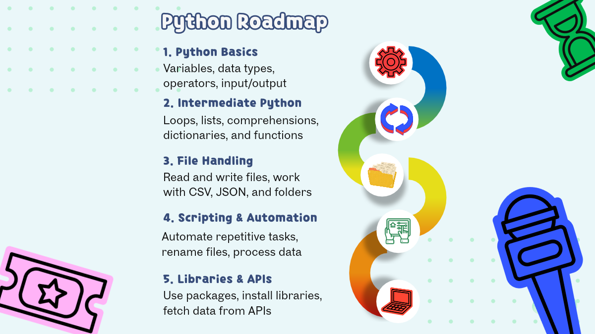
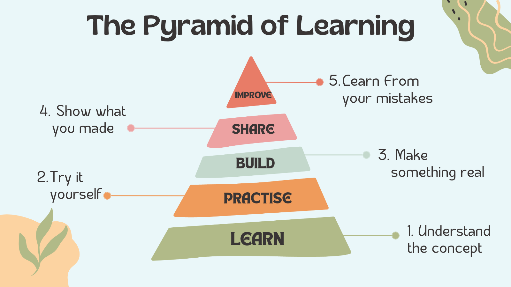
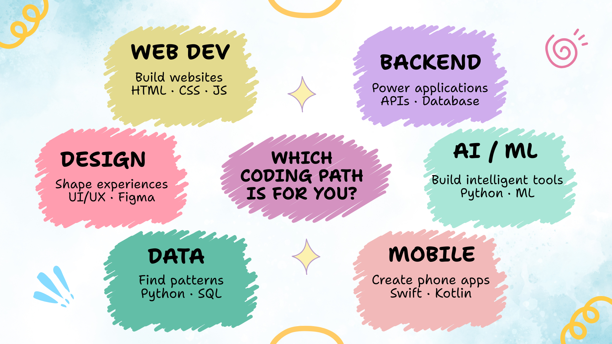
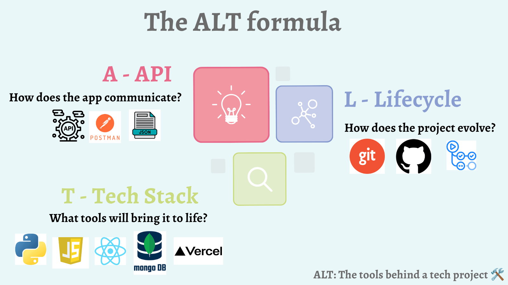

_This blog post was selected as the winner of the [Blog Post Monthly Challenge](https://www.codedex.io/community/monthly-challenge/QmKvL7JsnztrLvo4Ftrg/winners)._

## You've Decided to Learn Coding...

You open YouTube, search for `how to start programming`, and suddenly you're looking at Python, JavaScript, AI, web development, and approximately 47 different roadmaps. 😵‍💫

Where do you even start?!

Hey everyone! 👋 I'm [Tanisha](https://www.codedex.io/@tani-slays), and I've been coding for over eight years, on and off. 

Along the way, I've explored everything from Java and Python to Go, scripting, and game dev.

But if there's one thing I'd change about my coding journey, it's how I approached learning. My path wasn't always structured. Sometimes, I learned what my college curriculum required; other times, I picked up new technologies for projects or simply followed my curiosity. Some concepts were easy to understand, while others took plenty of trial and error.

Looking back, I realized something:

> _Learning to code isn't about learning everything._
> _It's about learning the right things, in the right order._
> _And putting them into practice consistently._

So, if I were starting from scratch in 2026 with zero knowledge, here's what I'd do differently!

---

## A Little Throwback to My Coding Journey 👩🏽‍💻

My first experience with programming goes all the way back to 2014, when I tried building a game similar to _[Subway Surfers](https://en.wikipedia.org/wiki/Subway_Surfers)_ using Unity. We never got around to publishing it, but looking back, it was one of my earliest introductions to coding.

In college, programming became more curriculum-driven. I learned [C/C++](https://codedex.io/cpp), and [Java](https://codedex.io/java), along with [Data Structures & Algorithms](https://codedex.io/data-structures-and-algorithms), and computer science fundamentals. Later, during my master's, I explored [Python](https://codedex.io/python), [Machine Learning](https://codedex.io/machine-learning), Go, and several other technologies. I've also explored [Lua](https://codedex.io/lua) through Codédex and experimented with design tools like [Figma](https://www.codedex.io/ui-ux-design).

My journey has taken me in many directions, and that's something I love about technology: there's always something new to discover. 

<Quote text="But if I were beginning again, I wouldn't try to learn everything at once. I'd build a solid foundation first, learn by doing, and explore different paths once I got the basics down." />

And that's exactly how I'd approach learning to code from scratch.

---

## Stage 1: Build Your Foundation 🧱

Before diving into AI, building apps, or tackling complex projects, I'd focus on the fundamentals.

You don't need five programming languages, an elaborate roadmap, or a perfect plan to begin. 

You need one manageable first step.

### Step 1: Pick One Beginner-Friendly Language

If you're completely new to programming, I'd consider starting with [Python](https://codedex.io/python). 🐍

**Why Python?**

- Its syntax is relatively readable, making it easier to focus on programming concepts.
- You can build useful programs without getting overwhelmed by complex syntax.
- It opens up possibilities in automation, backend development, data science, and AI.

If your main goal is to build websites, starting with [HTML](https://codedex.io/html), [CSS](https://codedex.io/css), and [JavaScript](https://codedex.io/javascript) is also a reasonable choice. You don't have to follow exactly the same path as everyone else.

For this roadmap, I'll use Python as the example.

I'd start with the [Python course on Codédex](https://www.codedex.io/python), as it encourages you to write code as you learn.

I'd follow this progression: start with Python basics, move on to intermediate concepts, learn to work with files, explore scripting and automation, and finally experiment with libraries and APIs.

Here's a quick roadmap to help you visualize the journey.

Don't rush through topics just to finish a course. Make sure you understand what your code is doing. When something doesn't make sense, slow down, experiment, and try explaining it in your own words.

  <a
    href="https://www.codedex.io/python"
    style={{ all: "unset" }}
    target="_blank"
    and
    rel="noopener noreferrer"
  >
    <Button variant="yellow">Learn Python</Button>
  </a>

### Step 2: Learn to Think Like a Programmer

Coding isn't just about memorizing syntax. It's about breaking a problem into smaller pieces and figuring out how to solve it.

As you become comfortable with the basics, start developing these skills:

- **Problem-solving:** Break a big task into smaller, manageable steps.
- **Debugging:** Read error messages and investigate why something isn't working.
- **Readable code:** Use meaningful names and organize your code so others can follow it.
- **Data structures & algorithms (DSA):** Organize data and solve problems efficiently.
- **Git & GitHub:** Track changes to your code, collaborate with others, and share your work.

You don't need to become a competitive programmer overnight. Learn these concepts gradually and practice applying them.

And please, don't feel discouraged when your code doesn't work. Debugging is part of programming. Even experienced developers spend time figuring out why something broke.

The goal isn't to write perfect code on your first attempt. It's to understand the problem, try a solution, learn from the mistakes, and improve.

---

## Stage 2: Learn by Building, Not Watching 🚀

This is where I'd do things differently if I were starting over.

It's easy to spend hours watching tutorials, bookmarking resources, and feeling productive without actually building anything yourself.

But there's a difference between understanding someone else's code vs. writing your own.

I'd follow a simple learning cycle: **learn, practice, build, share, improve, and repeat.**

For example, after learning Python loops and conditionals, you could build a number-guessing game. Once you understand lists and dictionaries, you could turn that knowledge into a quiz application.

Your first project doesn't need to be groundbreaking. It just needs to help you practice.

I'd rather finish one small project that I understand than have ten unfinished projects copied from tutorials.

And don't be afraid to experiment. Change the code, add a feature, break something, and figure out how to fix it. That's where a lot of the learning happens.

---

## Stage 3: Explore Different Paths in Tech 🧭

Once you have the basics, you don't need to follow the same path as everyone else. Programming has many branches, and you might discover that you enjoy something completely different from what you first imagined.

Here are a few directions you could explore. You don't have to choose one immediately; use these as starting points to explore what you want to pursue.

### 🌐 Web Development

If you want to build websites and web applications, start with:

- [HTML](https://codedex.io/html) to structure webpages.
- [CSS](https://codedex.io/css) to style them.
- [JavaScript](https://codedex.io/javascript) to add interactivity.
- [Git & GitHub](https://codedex.io/git-github) to manage and share your projects.

Once you're comfortable with the basics, you can explore tools and frameworks such as [React](https://codedex.io/react). 

**Project idea:** A personal website or portfolio is a good way to practice because you can keep improving it as you learn.

### ⚙️ Backend Development

If you're curious about what happens behind the scenes when you click a button or submit a form, backend development might be for you.

Learn about a language such as Python, a framework such as FastAPI or Django, databases and [SQL](https://codedex.io/sql), APIs and HTTP, testing, and basic security. Later, you can explore languages such as Java or Go, depending on the systems you want to build.

**Project idea:** Build a task manager with a database, user accounts, and an API.

### 🤖 AI and Machine Learning

AI is everywhere in 2026, so it's understandable if you want to jump straight in. I'd still build a foundation first.

Start with:

- Python fundamentals and data handling.
- Basic mathematics, including probability and statistics.
- Core machine learning concepts and scikit-learn.
- Followed by PyTorch or TensorFlow when appropriate.

You can also explore generative AI, large language models, and applications that use AI APIs as you progress.

You don't need to master every mathematical detail before building something interesting. However, understanding the fundamentals will help you move beyond simply copying code from tutorials.

**Project idea:** Build a simple recommendation system, a text classifier, or an AI-powered application.

### 📱 Mobile Development 

If you'd rather build applications for phones, you have several options:

- **Android:** Kotlin and Android Studio.
- **iOS:** Swift and Apple's development tools.
- **Cross-platform:** Flutter with Dart, or React Native with JavaScript or TypeScript.

Choose a path based on the devices you want to build for and the development experience you enjoy.

**Project idea:** Build a habit tracker, a budgeting app, or a simple to-do list.

### 📊 Data Science 

If you enjoy finding patterns, working with numbers, and answering questions using data, explore:

- [Python](https://codedex.io/python) and [SQL](https://codedex.io/sql).
- [NumPy](https://codedex.io/numpy) and [Pandas](https://codedex.io/pandas) for working with data.
- [Matplotlib](https://codedex.io/matplotlib) for data visualization.
- Basic statistics and probability.

**Project idea:** Analyze your music listening habits, visualize sports statistics, or explore a dataset that genuinely interests you.

### 🎨 Design and the Creative Side of Tech

You don't have to spend all your time writing code to have a place in tech. Maybe you enjoy designing interfaces more than debugging backend logic, creating prototypes, or thinking about how people interact with products.

You could explore Figma, UI/UX design fundamentals, and HTML and CSS to understand how designs translate into websites. If you enjoy both sides, you can combine design and programming to bring your ideas to life.

**Project idea:** Design a mobile app in Figma, then try building a working version of it.

### 🔐 Cybersecurity 

If you're curious about how systems are attacked and how applications can be made more secure, cybersecurity might be worth exploring.

Start with networking fundamentals, Linux and command-line basics, some Python scripting, and security concepts such as authentication and common vulnerabilities. Practice through legal labs and beginner-friendly challenges, and only test systems where you have permission.

**Project idea:** Complete beginner cybersecurity labs and write a report explaining a vulnerability and how to prevent it.

You don't need to explore every path. Pick the one that sparks your curiosity, try it for a little while, and see how it feels. Changing direction later is completely normal.

---

## Stage 4: The Resources I'd Actually Use 📚

The internet is full of tutorials, courses, documentation, and project ideas. The abundance is great, but it can also become a distraction. You can spend weeks collecting resources without writing a single line of code.

You don't need dozens of courses to learn coding. A few good resources and consistent practice are enough to get started.

Here are some I'd bookmark:

- [Codédex](https://www.codedex.io/): Interactive, beginner-friendly coding lessons.
- [MDN Web Docs](https://developer.mozilla.org/): Reference for HTML, CSS, and JavaScript.
- [Kaggle](https://www.kaggle.com): Explore data science and machine learning datasets.
- [TryHackMe](https://tryhackme.com/): Interactive platform to learn cybersecurity.
- [freeCodeCamp](https://www.youtube.com/@freecodecamp): Full-length course videos on YouTube.

One rule I'd follow: don't fall into tutorial hell. After following a tutorial, try recreating the project without looking at the original code. Add a feature, experiment, and make it your own.

---

## Stage 5: Build Small Projects + Keep Improving 🛠️

Here's the advice I'd want every beginner to remember: **don't just learn to code, use code to build something.**

You don't need to create the next big startup or build a complicated AI application in your first month. Start with something manageable, finish it, and improve it as you learn.

For example:

- 🐍 **Python basics:** Build a number-guessing game.
- 📊 **Working with data:** Create a quiz app or expense tracker.
- 🎨 **HTML & CSS:** Design your own personal website.
- ⚡ **JavaScript:** Build an interactive to-do list.
- 🔌 **APIs & databases:** Create a task manager that saves your data.
- 🤖 **Data science & AI:** Make a data visualization or a small AI-powered tool.

These are starting points, not assignments you must complete in order. Choose an idea that interests you. If a project feels too big, strip it back to its simplest useful version.

Once you have something working, ask yourself:

- What could make this easier to use?
- What happens if someone enters unexpected input?
- Can I organize the code more clearly?
- Could I add one small feature?
- Can I explain how it works to someone else?

That's how a small exercise can become a project you're proud to share. You learn not only syntax, but also how to make decisions, solve problems, and improve something over time.

And don't worry if your first few projects aren't particularly impressive. They're stepping stones. The skills you build while making them are what matter.

---

## My ALT Formula for Building Tech Projects 🧩

Once you're ready to think beyond individual coding exercises, here's a simple framework I use when thinking about projects: **ALT**.

**A: API**
How will different parts of your application communicate? Do you need to connect to an external service or let another application access your data?

**L: Lifecycle**
What's the journey of your project, from the initial idea and planning to development, testing, deployment, and maintenance?

**T: Tech Stack**
Which programming languages, frameworks, databases, and tools make sense for what you're trying to build?

You don't need perfect answers before you start. Think of these as prompts to help you plan, make decisions, and understand what goes into building a working application.

Not every beginner project needs an API or a complicated tech stack; use the parts that make sense for your idea. It's a personal framework I find useful for thinking about projects beyond just writing code.

---

## My Final Two Cents 🪙🪙

From trying to build a game in Unity in 2014 to exploring Python, Golang, Lua, and more, one thing I've learned is that learning to code isn't a straight line.

You'll try things you don't enjoy. You'll get stuck on problems that seem ridiculously simple in hindsight. You'll build projects that never get published. And you might discover a new interest when you least expect it. That's all part of the journey.

If I were starting from scratch today, I'd focus on learning the fundamentals, building small projects, and exploring different areas of tech along the way.

You don't need to know everything to get started. You just need to start.

So, if you've been thinking about learning to code, take this as your sign. Pick a beginner-friendly path, write your first few lines of code, and see where the journey takes you.

Thanks for reading, and happy coding! 👩‍💻✨

See you in the next one. Bye! 💙
