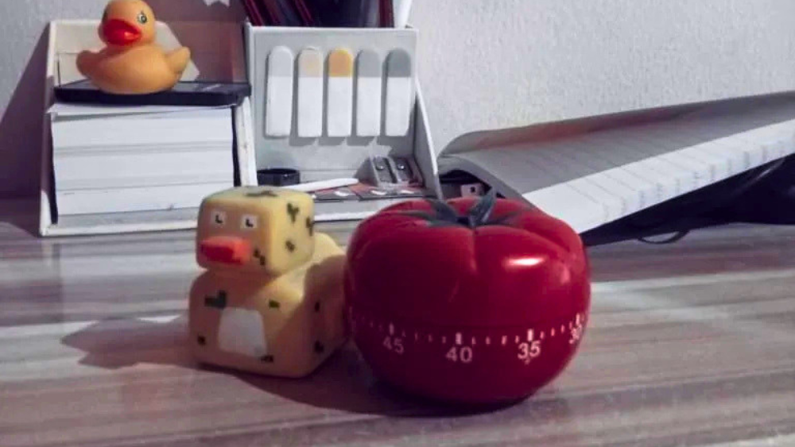

_This blog post was selected as the winner of the [Blog Post Monthly Challenge](https://www.codedex.io/community/monthly-challenge/QmKvL7JsnztrLvo4Ftrg/winners)._

## The Light Bulb Moment

Ever spent hours trying to solve a problem or fix a bug, only to find the answer while taking a shower or arguing with your housemate about something completely unnecessary? 🧠💡

Well, your brain might be trying to tell you something. 

Because shower thoughts are [REAL](https://medium.com/@truthiness/the-hidden-value-of-shower-thoughts-5ae9aef7b3c5). 

Hi, I'm [Chimobi](https://www.codedex.io/@MrEkwunife), a Fullstack Engineer and student from Nigeria. As someone who codes and studies Computer Science, I've come to realise that solving problems isn't always about staring at your screen for hours or trying to brute-force your way to an answer. 

Sometimes, the best thing you can do is take a step back and let your brain do its thing. 💆🏾‍♂️

In this blog post, I'll share a few things I've learned about how our brains work, particularly when it comes to learning, solving problems, and dealing with that annoying feeling of not being smart enough to understand something.

We'll explore two modes of thinking, the Einstellung effect, and something called befuddlement. 

Don't worry, I promise not to sound like a neuroscience professor!

<Quote text="Sometimes you need to be less focused in order to become a better learner.” - Dr. Babara Oakley (Learning How to Learn)" />

---

## Focus Mode: Your Brain Puts on Its Thinking Cap

Let's start with the first mode of thinking: focus mode.

**Focus mode** is activated when we direct our attention towards something. Yep, it's that simple to get into this mode. It's the kind of thinking we use when we concentrate on a particular task and try to solve a problem using what we already know. 🎯✨

This mode is particularly useful when we have _some background knowledge_ of the problem we're trying to solve. Our brains rely on familiar patterns and connections, allowing us to work through the problem step by step. However, it might not be as useful on its own when we are trying to learn something entirely new. 

In many ways, this is similar to how generative AI models work.

Think of focus mode as a tightly coupled pinball machine. By tightly coupled, I mean that the rubber bumpers inside the machine are very close together. When a ball is released from the spring-loaded plunger, it does not travel very far before hitting another bumper. It keeps bouncing around within a relatively small area.

Our brains work similarly when we activate focus mode. Our thoughts move along familiar pathways, allowing us to concentrate on a specific problem and work towards a solution. 🔎

But here's the catch: Sometimes, focusing hard won't get us closer to the answer. When we're stuck, we might need to approach the problem from a different angle.

---

## Diffuse Mode: Let Your Brain Roam Free

That's where diffuse mode comes in!

**Diffuse mode** deals with the bigger picture. Rather than concentrating on a small area, it helps us approach problems more broadly and make connections we might otherwise miss. 🏞️✨

In this mode of thinking, we take a step back and look at the bigger picture of the problem we are trying to solve. It's particularly useful when learning something \~_new_\~, especially when the information does not immediately connect with anything we already understand. Our brain try to figure out where the new information fits into what we already know.

Let's use our pinball analogy again:

<Caption text="Focus mode vs. Diffuse mode. A Mind for Numbers (2014)." />

Unlike the tightly packed bumpers in focus mode (left), the bumpers in diffuse mode (right) are spread further apart. This allows the ball to travel farther across the machine before hitting another bumper. In the same way, diffuse mode allows our thoughts to wander beyond familiar pathways, helping us make new connections and approach problems from different angles.

Sometimes, the answer you have been desperately searching for while staring at your screen becomes obvious when you are taking a walk or doing something completely unrelated.

Funny how that works, isn't it?

---

## The Einstellung Effect: Stuck on the First Idea

The **Einstellung effect** is our tendency to stick with a familiar solution to a problem, even when a better solution might exist.

If you ask me, it's what happens when focus mode refuses to mind its business!

You see, this effect can prevent us from discovering alternative solutions because we become fixated on one particular approach. We keep trying to solve the problem using the same method, even when that method is not working. Let me give you an analogy...

Imagine you are in a dark room with a torch. 🔥

If you point the torch directly at a particular spot, that area becomes brightly illuminated. You might even spot a few ants crawling around (if there are any!). 🐜 🐜 🐜 However, the rest of the room remains dark and hidden. That's what happens when we become fixated on one approach. We concentrate so much on a single solution that we fail to notice other possibilities.

This is the Einstellung effect!

Now, imagine pointing that same torch towards the middle of the room. You can suddenly see much more of your surroundings, even if some corners aren't as illuminated. This is similar to diffuse mode. Rather than directing all our attention towards one area, we consider the bigger picture.

Of course, this doesn't mean one mode of thinking is better than the other: 

- 🎯 Focus mode helps us retrieve and apply what we already know.
- 🏞️ Diffuse mode allows us to explore new possibilities and make unexpected connections.

The trick is recognising when we're getting stuck in one way of thinking. The first solution that comes to mind isn't necessarily the best one. Sometimes, we need to step back and give ourselves room to explore other approaches.

And yes, this applies to coding too. Just because you've found a way to make your program work doesn't mean it's the best way to solve the problem. (Please, don't ask me how I know!)

---

## Switching Modes: The Pomodoro Technique

Now, understanding these modes is one thing. Knowing when to switch is another.

It can be difficult to consciously switch between the two, especially when you are deep into a problem and desperatee for an answer. One hack that works for me is the Pomodoro Technique.

The **Pomodoro Technique** is a time management method developed in the late 80s by Francesco Cirillo. The theory is that taking frequent breaks can help improve your mental focus and prevent burnout. It can provide a better sense of accomplishment by breaking tasks into smaller chunks. For these reasons, this technique is quite popular with programmers. 

The idea is simple:

1. Set a timer for 25 minutes and focus on the task at hand. 
2. Once the time is up, take a five-minute break as a little reward for your hard work.
3. Repeat!

Each interval is known as a _pomodoro_, Italian word for tomato. 🍅🤌🏾

And here's the important part: try to stay away from screens and phones during that break.

Why?? Because doomscrolling social media still demands attention. You're simply switching from one activity to another rather than giving your brain an opportunity to truly rest.

A screen-free break gives you some breathing room. It allows your thoughts to wander, which might help you return to the original problem with a fresh perspective.

Here are a few things you could try during your break:

- 🚶🏾‍♂️ Get some fresh air.
- 🐱 Chill with your pet.
- 💭 Get lost in your thoughts.
- 🍵 Make a cup of tea.
- 🛁 Take a shower.
- 🤦🏾‍♂️ Start an unnecessary but entertaining argument with your housemate. (Sorry, Ugo! 😉)
- 🗣️ Talk to your rubber duck. (Hey, I said you should do it. I didn't say I do it! 😂)

After any of these short breaks, you might find that something feels different about how you approach the problem. You might see something you completely missed before.

One thing worth remembering is that the goal of those 25 min isn't necessarily to finish the task. It's to give yourself a manageable period of uninterrupted concentration. The idea is to break your work into shorter periods of concentration rather than forcing yourself to focus for hours.

Feel free to adjust the time durations. These days, I do 30 minutes of focus and 6 minutes of break.

Oh, and I actually use a physical timer to keep myself away from screens entirely:

<Caption text="A physical Pomodoro timer (and rubber ducks) to stay screen-free." />

---

## Befuddlement: Not as Clueless as You Think

Have you ever faced a problem that made you feel not smart enough to solve it?

Maybe you're trying to understand a new programming concept, debug a stubborn error, or work through a difficult topic in a CS course. You've tried everything you can think of, but nothing makes sense. Eventually, you start questioning your abilities and wondering whether you're even cut out for this.

Well, before you start doubting yourself, let me introduce you to befuddlement.

**Befuddlement** is a state of confusion or bewilderment, often leaving you unsure how to approach or understand something, as though you lack the mental capacity. 😵

You are pulling your hair out and feeling the urge to abandon the problem altogether. Before you do, try breaking it down.

Start by understanding the problem better. In many cases, figuring out what you're actually being asked to solve is already a big part of the solution.

Next, identify what specifically confuses you. Is there a concept you don't understand? A step that doesn't make sense? An assumption that might be wrong?

Once you identify the confusing part, you can focus on understanding it instead of feeling overwhelmed by the entire problem. By the time you've worked through those confusing bits, you might find you've already solved the problem!

So, the next time a problem makes you feel like your brain has packed its bags and travelled to another country, take a breath. Break it down and work through the confusing parts one at a time.

You're probably more capable than you think. (Yes, tell them I said so!)

---

## A Little Disclaimer Before You Call Me Professor

I know, I might sound like a neuroscience expert here, but I promise you, I’m not.

I am just a young lad who codes and majors in CS.

As a matter of fact, most of the ideas in this blog come from books I have read, particularly _A Mind for Numbers_, _Learning Like a Pro_, and _Learning How to Learn_, written by [Dr. Barbara Oakley](https://barbaraoakley.com/) and other authors.

(Oh yes! I love that woman!)

These ideas are hers, not mine. She is the true expert.

Maybe one day, I will become an expert, too. For now, I'm simply someone who enjoys learning about how we learn and sharing what I discover along the way.

If any of these ideas interest you, I encourage you to get copies of these books and explore them yourself. You might discover a few things that change how you approach learning, solving problems, and understanding your own brain.

---

## One Last Thing...

Thank you so much for reading this blog to the very end. I hope you learnt something useful and that the next time you find yourself stuck on a problem, you remember that staring at it for another three hours might not be the solution.

Sometimes, you need to focus. Sometimes, you need to step back. 

And sometimes, you just need to take a shower. 🧖🏾‍♂️🫧🚿

Hopefully, my sister (\*_cough, cough, Hazel_\*) reads this blog to the end and realizes that I actually enjoy reading books. That way, she might be encouraged to send me more books. 😂

Hahaha. Thanks for reading! 🙏🏾

### Recommended Reading

- [_A Mind for Numbers: How to Excel at Math and Science (Even If You Flunked Algebra)_](https://barbaraoakley.com/books/a-mind-for-numbers/) by Dr. Barbara Oakley
- [_Learning How to Learn: How to Succeed in School Without Spending All Your Time Studying_](https://barbaraoakley.com/books/learning-how-to-learn/) by Dr. Barbara Oakley & Terrence Sejnowski
- [_Learning Like a Pro: Science-Based Tools to Become Better at Anything_](https://barbaraoakley.com/books/learning-like-a-pro/) by Dr. Barbara Oakley & Olav Schewe
