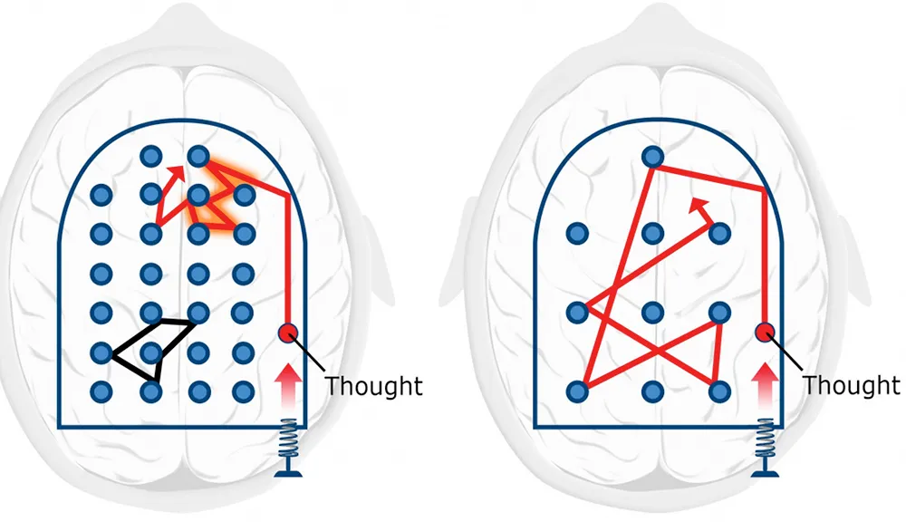
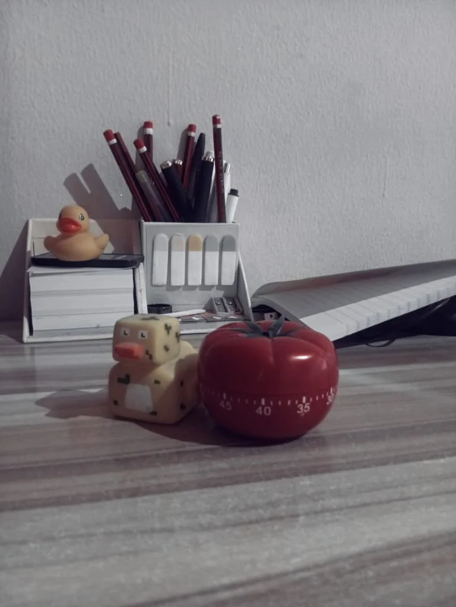

_This blog post was selected as the winner of the [Blog Post Monthly Challenge](https://www.codedex.io/community/monthly-challenge/QmKvL7JsnztrLvo4Ftrg/winners)._

## The Light Bulb Moment

Ever spent hours trying to solve a problem or fix a bug, only to find the answer while taking a shower or arguing with your housemate about something completely unnecessary? 🧠💡

Well, your brain might be trying to tell you something. 

Because shower thoughts are [REAL](https://medium.com/@truthiness/the-hidden-value-of-shower-thoughts-5ae9aef7b3c5). 

Hi, I'm [Chimobi](https://www.codedex.io/@MrEkwunife), a Fullstack Engineer and student from Nigeria. As someone who codes and studies Computer Science, I've come to realise that solving problems isn't always about staring at your screen for hours or trying to brute-force your way to an answer. 

Sometimes, the best thing you can do is take a step back and let your brain do its thing. 💆🏾‍♂️

In this blog post, I'll share a few things I've learned about how our brains work, particularly when it comes to learning, solving problems, and dealing with that annoying feeling of not being smart enough to understand something.

We'll explore two modes of thinking, the Einstellung effect, and something called befuddlement. 

Don't worry, I promise not to sound like a neuroscience professor!

<Quote text="Sometimes you need to be less focused in order to become a better learner.” - Dr. Babara Oakley (Learning How to Learn)" />

---

## Focus Mode: Your Brain Puts on Its Thinking Cap

Let's start with the first mode of thinking: focus mode.

**Focus mode** is activated when we direct our attention towards something. Yep, it's that simple to get into this mode. It's the kind of thinking we use when we concentrate on a particular task and try to solve a problem using what we already know. 🎯✨

This mode is particularly useful when we have _some background knowledge_ of the problem we're trying to solve. Our brains rely on familiar patterns and connections, allowing us to work through the problem step by step. However, it might not be as useful on its own when we are trying to learn something entirely new. 

In many ways, this is similar to how generative AI models work.

Think of focus mode as a tightly coupled pinball machine. By tightly coupled, I mean that the rubber bumpers inside the machine are very close together. When a ball is released from the spring-loaded plunger, it does not travel very far before hitting another bumper. It keeps bouncing around within a relatively small area.

Our brains work similarly when we activate focus mode. Our thoughts move along familiar pathways, allowing us to concentrate on a specific problem and work towards a solution. 🔎

But here's the catch: Sometimes, focusing hard won't get us closer to the answer. When we're stuck, we might need to approach the problem from a different angle.

---

## Diffuse Mode: Let Your Brain Roam Free

That's where diffuse mode comes in!

**Diffuse mode** deals with the bigger picture. Rather than concentrating on a small area, it helps us approach problems more broadly and make connections we might otherwise miss. 🏞️✨

In this mode of thinking, we take a step back and look at the bigger picture of the problem we are trying to solve. It's particularly useful when learning something \~_new_\~, especially when the information does not immediately connect with anything we already understand. Our brain try to figure out where the new information fits into what we already know.

Let's use our pinball analogy again:

<Caption text="Focus mode vs. Diffuse mode. A Mind for Numbers (2014)." />

Unlike the tightly packed bumpers in focus mode (left), the bumpers in diffuse mode (right) are spread further apart. This allows the ball to travel farther across the machine before hitting another bumper. In the same way, diffuse mode allows our thoughts to wander beyond familiar pathways, helping us make new connections and approach problems from different angles.

Sometimes, the answer you have been desperately searching for while staring at your screen becomes obvious when you are taking a walk or doing something completely unrelated.

Funny how that works, isn't it?

---

## The Einstellung Effect: Stuck on the First Idea

The **Einstellung effect** is our tendency to stick with a familiar solution to a problem, even when a better solution might exist.

If you ask me, it's what happens when focus mode refuses to mind its business!

You see, this effect can prevent us from discovering alternative solutions because we become fixated on one particular approach. We keep trying to solve the problem using the same method, even when that method is not working. Let me give you an analogy...

Imagine you are in a dark room with a torch. 🔥

If you point the torch directly at a particular spot, that area becomes brightly illuminated. You might even spot a few little ants crawling around (if there are any!). 🐜 🐜 🐜 However, the rest of the room remains dark and hidden from view.

That's what happens when we become fixated on one approach. We concentrate so much on a single solution that we fail to notice other possibilities.

This is the Einstellung effect!

Now, imagine taking that same torch and pointing it towards the middle of the room. You can see more of the room, although the light might not be as bright in every corner. You might not even notice a glimpse of our little ant, assuming it is actually there.

This is similar to diffuse mode. Instead of concentrating all our attention on one particular area, we take a step back and look at the bigger picture.

Now, this is not to say that one mode of thinking is better than the other. As I mentioned earlier, focus mode is useful for retrieving and applying knowledge we already have, while diffuse mode helps us explore broader possibilities and make new connections.

The important thing is to recognise when we might be stuck in the Einstellung effect.

The first solution that comes to mind might not always be the right one. Sometimes, you need to take a step back, look at the problem from a broader perspective, and consider other approaches.

And yes, this applies to coding too. Just because you have found a way to make your code work does not mean it is the best way to solve the problem. (Please, don't ask me how I know!)

---

## Switching Modes: The Pomodoro Technique to the Rescue!

Now, knowing about these two modes of thinking is one thing. Knowing when to switch between them is another.

It can be difficult to consciously switch between the two modes, especially when you are deep into solving a problem and desperately want to figure it out.

One approach that works for me is the **Pomodoro Technique**.

The idea is simple. Set a timer for 25 minutes and focus on the task at hand. Actually do the work for those 25 minutes without distractions. Once the time is up, take a five-minute break as a little reward for your hard work.

It goes without saying that you should stay away from screens and phones during this break.

Why?

Because even when you are no longer working on the original task, scrolling through social media or watching videos still demands your attention. You are simply focusing on something else instead of giving your brain a chance to rest.

Taking a break away from screens gives you an opportunity to relax and let your thoughts wander. This can help you approach the problem you have been working on with a fresh perspective.

Here are a few things you can do during your break:

- Get lost in your thoughts.
- Take a walk.
- Start an unnecessary but very entertaining argument with your housemate. (Sorry, Ugo! 😉)
- Take a quick shower.
- Walk your pet.
- Talk to your rubber duck. (Hey, I said you should do it. I didn't say I do it! 😂)

After any of these short breaks, you might find that something feels different about how you approach the problem. You may even discover a solution you could not see before.

It is important to note that the goal of those 25 minutes is not necessarily to finish a particular task. Rather, it is to work diligently on the problem for a manageable period without distractions.

The idea is to break your work into shorter periods of concentration rather than forcing yourself to focus for hours on end.

Feel free to adjust the focus time and break time to suit yourself. These days, I use 30 minutes of focus followed by a six-minute break.

Oh, and I actually use a physical timer to keep myself away from screens entirely. Yes, a physical timer! We are not allowing any sneaky phone notifications to ruin the plan. (Psst, do not mind the ducks!)

<Caption text="A physical Pomodoro timer (and rubber ducks) to stay screen-free." />

---

## Befuddlement: You Are Probably Not As Clueless As You Think

Have you ever encountered a problem that made you feel like you were not smart enough to solve it?

Maybe you are trying to understand a new programming concept, debug a stubborn error, or work through a difficult topic in your computer science course.

You have tried everything you can think of, but nothing seems to make sense. Eventually, you start questioning your abilities and wondering whether you are even cut out for this.

Well, before you start doubting yourself, let me introduce you to **befuddlement**.

Sometimes, a problem can leave you feeling confused and overwhelmed. You might feel as though you do not have the mental capacity to solve it.

But that feeling does not automatically mean you are incapable of solving the problem. Sometimes, you simply need a different approach.

At this point, you might feel the urge to abandon the problem altogether. Before you do that, try breaking it down.

Start by understanding the question or problem better. In many cases, understanding what you are actually being asked to solve is already a significant part of the solution.

Next, identify the specific part that confuses you. Is there a concept you do not understand? Is there a particular step that does not make sense? Are you making an assumption that might be wrong?

Once you identify the confusing part, you can focus on understanding it instead of feeling overwhelmed by the entire problem.

And by the time you have worked through those confusing bits, you might find that you have already solved the problem!

So, the next time a problem makes you feel like your brain has packed its bags and travelled to another country, take a breath. Break the problem down, understand what you can, and work through the confusing parts one at a time.

You are probably more capable than you think. (Yes, tell them I said so!)

---

## A Little Disclaimer Before You Call Me Professor

I know, I might sound like a neuroscience expert here, but I promise you, I’m not.

I am just a young lad who codes and majors in CS.

As a matter of fact, most of the ideas in this blog come from books I have read, particularly _A Mind for Numbers_, _Learning Like a Pro_, and _Learning How to Learn_, written by [Dr. Barbara Oakley](https://barbaraoakley.com/) and other authors.

(Oh yes! I love that woman!)

These ideas are hers, not mine. She is the true expert.

Maybe one day, I will become an expert, too. For now, I'm simply someone who enjoys learning about how we learn and sharing what I discover along the way.

If any of these ideas interest you, I encourage you to get copies of these books and explore them yourself. You might discover a few things that change how you approach learning, solving problems, and understanding your own brain.

---

## One Last Thing...

Thank you so much for reading this blog to the very end. I hope you learnt something useful and that the next time you find yourself stuck on a problem, you remember that staring at it for another three hours might not be the solution.

Sometimes, you need to focus. Sometimes, you need to step back. 

And sometimes, you just need to take a shower. 🧖🏾‍♂️🫧🚿

Hopefully, my sister (\*_cough, cough, Hazel_\*) reads this blog to the end and realizes that I actually enjoy reading books. That way, she might be encouraged to send me more books. 😂

Hahaha. Thanks for reading! 🙏🏾

### Recommended Reading

- [_A Mind for Numbers: How to Excel at Math and Science (Even If You Flunked Algebra)_](https://barbaraoakley.com/books/a-mind-for-numbers/) by Dr. Barbara Oakley
- [_Learning How to Learn: How to Succeed in School Without Spending All Your Time Studying_](https://barbaraoakley.com/books/learning-how-to-learn/) by Dr. Barbara Oakley & Terrence Sejnowski
- [_Learning Like a Pro: Science-Based Tools to Become Better at Anything_](https://barbaraoakley.com/books/learning-like-a-pro/) by Dr. Barbara Oakley & Olav Schewe
